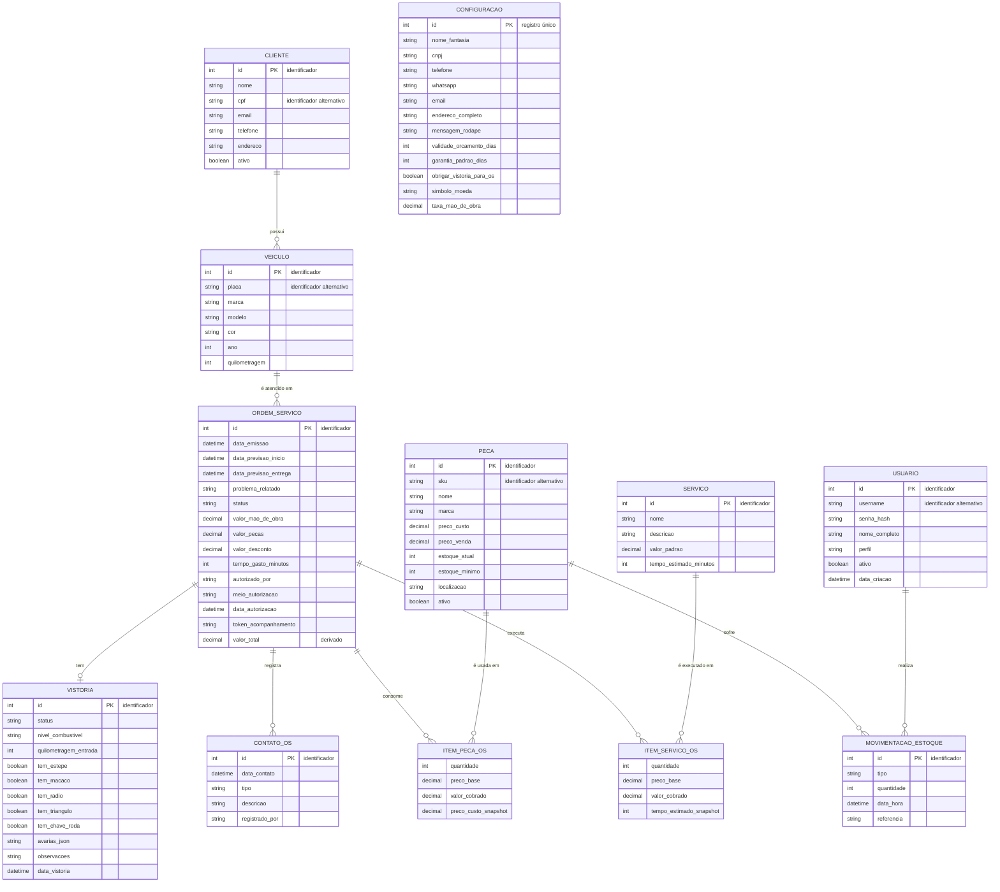
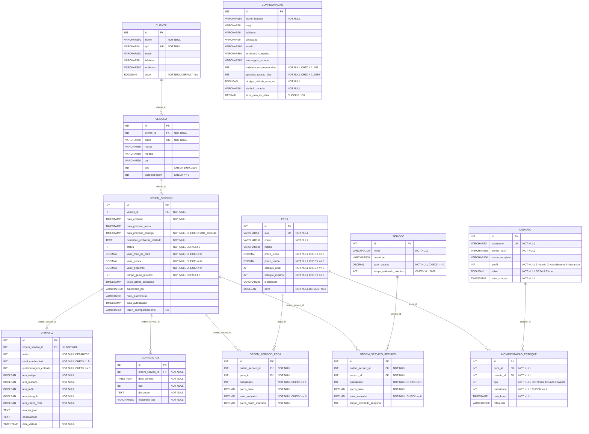

# Projeto Semestral — Etapa 1: Modelagem de Dados

**Sistema modelado:** MechSystem (gestão de oficina mecânica) — base: Projeto Integrador do semestre.

> Os diagramas abaixo são Mermaid. Para visualizar: preview do VS Code (extensão *Markdown Preview Mermaid Support*), GitHub, ou colar o código em <https://mermaid.live> para exportar PNG/PDF.

---

## 1. Definição do contexto do sistema

### 1.1 Nome / tema
**MechSystem** — sistema web para gestão de oficinas mecânicas (clientes, veículos, ordens de serviço, vistoria de entrada e controle de estoque de peças).

### 1.2 Problema / necessidade
Oficinas pequenas e médias controlam orçamentos, ordens de serviço (OS) e estoque em papel ou planilhas. Isso gera:
- perda de histórico do cliente e do veículo;
- orçamentos sem registro de autorização (risco jurídico — CDC);
- divergência entre estoque físico e real de peças;
- falta de rastreio de quem alterou preços ou deu desconto;
- ausência de registro do estado do veículo na entrada (disputas por avarias).

O sistema centraliza esses dados e garante que as regras da oficina sejam respeitadas.

### 1.3 Principais usuários / envolvidos
| Envolvido | Papel |
|---|---|
| **Administrador** | Configura a oficina, gerencia usuários, autoriza descontos |
| **Atendimento** | Cadastra clientes/veículos, abre orçamentos e OS, registra contatos |
| **Mecânico** | Executa serviços, registra tempo gasto, consome peças |
| **Cliente** | Contrata serviços, autoriza orçamentos, acompanha a OS por token |

### 1.4 Principais funcionalidades relacionadas aos dados
- Cadastro de clientes e seus veículos.
- Catálogo de serviços (valor padrão e tempo estimado) e de peças (SKU, custo, venda, estoque).
- Abertura de OS com peças e serviços, cálculo de total e controle de status.
- Vistoria de entrada (combustível, KM, itens do veículo, avarias).
- Registro de contatos com o cliente sobre a OS.
- Movimentação de estoque (entrada, saída, ajuste) com responsável.
- Controle de acesso por perfil e parâmetros globais da oficina.

### 1.5 Regras de negócio consideradas na modelagem
| # | Regra |
|---|---|
| RN01 | Um cliente pode ter vários veículos, mas cada veículo pertence a apenas **um** cliente. |
| RN02 | O CPF do cliente é obrigatório e **único**; a placa do veículo é obrigatória e **única**. |
| RN03 | Um veículo pode ter várias ordens de serviço ao longo do tempo; cada OS refere-se a **um único** veículo. |
| RN04 | Toda OS exige problema relatado e **data de previsão de entrega** (CDC), que não pode ser anterior à emissão. |
| RN05 | Uma OS tem no máximo **uma** vistoria de entrada; cada vistoria pertence a uma única OS. (A obrigatoriedade é parametrizável em `Configuracao`.) |
| RN06 | Uma OS pode conter várias peças e vários serviços; a mesma peça/serviço pode aparecer em várias OS, com **quantidade** e **valores próprios** por OS (relacionamentos N:M com atributos → entidades associativas). |
| RN07 | Ao incluir peça/serviço na OS, os valores de catálogo (preço base, custo, tempo) são **copiados** (snapshot); alterar o catálogo depois não altera OS antigas. |
| RN08 | Valor cobrado abaixo do preço base é desconto e exige perfil **Administrador**. |
| RN09 | Quantidades em OS e movimentações devem ser **≥ 1**; estoque atual e mínimo **não podem ser negativos**. |
| RN10 | O SKU da peça é único. Peça com movimentação ou usada em OS **não pode ser excluída** (restrição). |
| RN11 | Toda movimentação de estoque pertence a **uma** peça e é feita por **um** usuário (rastreabilidade). |
| RN12 | O nome de usuário é único; cada usuário tem exatamente **um** perfil (Administrador, Atendimento, Mecânico). |
| RN13 | Cada OS possui status único controlado por máquina de estados: `Orcamento`, `EmAndamento`, `Pausada`, `AguardandoPecas`, `Concluida` ou `Cancelada`. |
| RN14 | Uma OS pode ter vários registros de contato com o cliente (ligação, WhatsApp, e-mail, presencial, outro). |
| RN15 | Excluir uma OS remove seus itens (peças e serviços) em cascata. |
| RN16 | Existe **um único** registro de configuração da oficina (nome, CNPJ, validade do orçamento, garantia padrão etc.). |
| RN17 | Valor total da OS = mão de obra + peças − desconto (**atributo derivado**, não armazenado). |

> **Exemplo (como a regra aparece nos diagramas):** RN01 → relacionamento `CLIENTE (1,1) — possui — (0,N) VEICULO` no conceitual e `veiculo.cliente_id FK NOT NULL` no lógico.

---

## 2. Diagrama Conceitual (DER)

Notação de cardinalidade (mín,máx) lida a partir de cada entidade:

| Símbolo Mermaid | Significado |
|---|---|
| `\|\|` | exatamente um (1,1) |
| `o\|` | zero ou um (0,1) |
| `o{` | zero ou muitos (0,N) |
| `\|{` | um ou muitos (1,N) |

Entidades associativas: **ITEM_PECA_OS** (OS × PECA) e **ITEM_SERVICO_OS** (OS × SERVICO). **MOVIMENTACAO_ESTOQUE** também é associativa (PECA × USUARIO), com identidade própria por poder repetir-se.



### Cardinalidades (mín,máx)

| Relacionamento | Lado A | Lado B | Regra |
|---|---|---|---|
| CLIENTE **possui** VEICULO | CLIENTE (0,N) | VEICULO (1,1) | RN01 |
| VEICULO **é atendido em** ORDEM_SERVICO | VEICULO (0,N) | ORDEM_SERVICO (1,1) | RN03 |
| ORDEM_SERVICO **tem** VISTORIA | ORDEM_SERVICO (0,1) | VISTORIA (1,1) | RN05 |
| ORDEM_SERVICO **registra** CONTATO_OS | ORDEM_SERVICO (0,N) | CONTATO_OS (1,1) | RN14 |
| ORDEM_SERVICO **consome** PECA (assoc. ITEM_PECA_OS) | ORDEM_SERVICO (0,N) | PECA (0,N) | RN06 |
| ORDEM_SERVICO **executa** SERVICO (assoc. ITEM_SERVICO_OS) | ORDEM_SERVICO (0,N) | SERVICO (0,N) | RN06 |
| PECA **sofre** MOVIMENTACAO_ESTOQUE | PECA (0,N) | MOVIMENTACAO (1,1) | RN11 |
| USUARIO **realiza** MOVIMENTACAO_ESTOQUE | USUARIO (0,N) | MOVIMENTACAO (1,1) | RN11 |
| CONFIGURACAO | sem relacionamentos (parâmetros globais, registro único) | | RN16 |

---

## 3. Diagrama Lógico (Modelo Relacional)

Convenções: `PK` chave primária · `FK` chave estrangeira · `UK` restrição UNIQUE.
Valores `decimal` = `DECIMAL(18,2)`, exceto `taxa_mao_de_obra` (percentual 0–100). Campos de enum são armazenados como `INT`. `avarias_json` é `TEXT` com JSON.



### 3.1 Restrições adicionais (UNIQUE compostas e regras)

| Tabela | Restrição | Motivo |
|---|---|---|
| `ordem_servico_peca` | `UNIQUE (ordem_servico_id, peca_id)` | evita a mesma peça repetida em linhas na mesma OS (a quantidade controla o volume) — RN06 |
| `ordem_servico_servico` | `UNIQUE (ordem_servico_id, servico_id)` | idem para serviços — RN06 |
| `vistoria` | `UNIQUE (ordem_servico_id)` | garante a cardinalidade (0,1) da OS — RN05 |
| `cliente` | `UNIQUE (cpf)` | RN02 |
| `veiculo` | `UNIQUE (placa)` | RN02 |
| `peca` | `UNIQUE (sku)` | RN10 |
| `usuario` | `UNIQUE (username)` | RN12 |

### 3.2 Ações referenciais (ON DELETE)

| FK | Ação | Regra |
|---|---|---|
| `ordem_servico_peca.ordem_servico_id` | **CASCADE** | RN15 |
| `ordem_servico_servico.ordem_servico_id` | **CASCADE** | RN15 |
| `ordem_servico_peca.peca_id` | **RESTRICT** | RN10 |
| `movimentacao_estoque.peca_id` | **RESTRICT** | RN10 |
| `movimentacao_estoque.usuario_id` | **RESTRICT** | RN11 |
| `veiculo.cliente_id`, `ordem_servico.veiculo_id`, `vistoria.ordem_servico_id`, `contato_os.ordem_servico_id`, `ordem_servico_servico.servico_id` | RESTRICT (padrão) | preservar histórico |

### 3.3 Atributos derivados (não armazenados)
- `ordem_servico.valor_total = (mão de obra efetiva + peças efetivas) − desconto`
- `Subtotal` do item = `quantidade × valor_cobrado`
- Margem de lucro da peça = `(preco_venda − preco_custo) / preco_venda × 100`

---

## 4. Coerência entre os modelos

```
Regras de negócio  →  Modelo Conceitual  →  Modelo Lógico
```

| Conceitual | Lógico | Transformação |
|---|---|---|
| Entidade | Tabela | 1 para 1 |
| Atributo identificador | PK | `id` surrogate; identificadores naturais (CPF, placa, SKU, username) viram `UNIQUE` |
| Relacionamento 1:N | FK no lado N | `VEICULO.cliente_id`, `ORDEM_SERVICO.veiculo_id`, `CONTATO_OS.ordem_servico_id`, `MOVIMENTACAO_ESTOQUE.peca_id/usuario_id` |
| Relacionamento 1:(0,1) | FK + `UNIQUE` | `VISTORIA.ordem_servico_id UNIQUE` |
| Relacionamento N:M com atributos | Entidade associativa → tabela com 2 FKs | `ITEM_PECA_OS` → `ORDEM_SERVICO_PECA`; `ITEM_SERVICO_OS` → `ORDEM_SERVICO_SERVICO` |
| Cardinalidade mínima 1 (obrigatória) | `NOT NULL` na FK | todas as FKs |
| Atributo derivado | não persistido | `valor_total` |
| Entidade sem relacionamento | Tabela isolada | `CONFIGURACAO` |

---

## 5. Observações de aderência ao código atual (Pós-Estabilização)

Modelo derivado das entidades em `Models/` e do [AppDbContext.cs](../Data/AppDbContext.cs). Com o ciclo de estabilização:
- `cliente.cpf`, `veiculo.placa` e `ordem_servico.token_acompanhamento` possuem índices `UNIQUE` no banco PostgreSQL (além de normalização automática na aplicação).
- `ordem_servico.data_conclusao` foi adicionada (`TIMESTAMPTZ NULL`) e preenchida automaticamente na conclusão da OS para apuração financeira por competência de conclusão.
- `peca.xmin` (`Version`) foi configurado como token nativo de concorrência otimista do PostgreSQL (`IsRowVersion()`).
- Todas as colunas `DateTime` são persistidas em UTC (`timestamp with time zone`) via convenção global no `AppDbContext`.

Fora do escopo de tabelas próprias: classes `Relatorio*` (consultas/relatórios; não possuem `DbSet` no contexto) e `Login` (DTO de autenticação).

---

## 6. Roteiro sugerido para a apresentação (3–5 min)

1. **Contexto (1 min):** nome, problema, usuários, funcionalidades (seção 1).
2. **Regras de negócio (1 min):** destacar RN01, RN05, RN06, RN07 e RN08.
3. **Conceitual (1–2 min):** entidades, identificadores, cardinalidades e as 2 associativas.
4. **Lógico (1 min):** mostrar a conversão (seção 4), PKs/FKs, `UNIQUE`, `NOT NULL` e `ON DELETE`.
5. **Coerência:** demonstrar RN01 do conceitual ao lógico.
