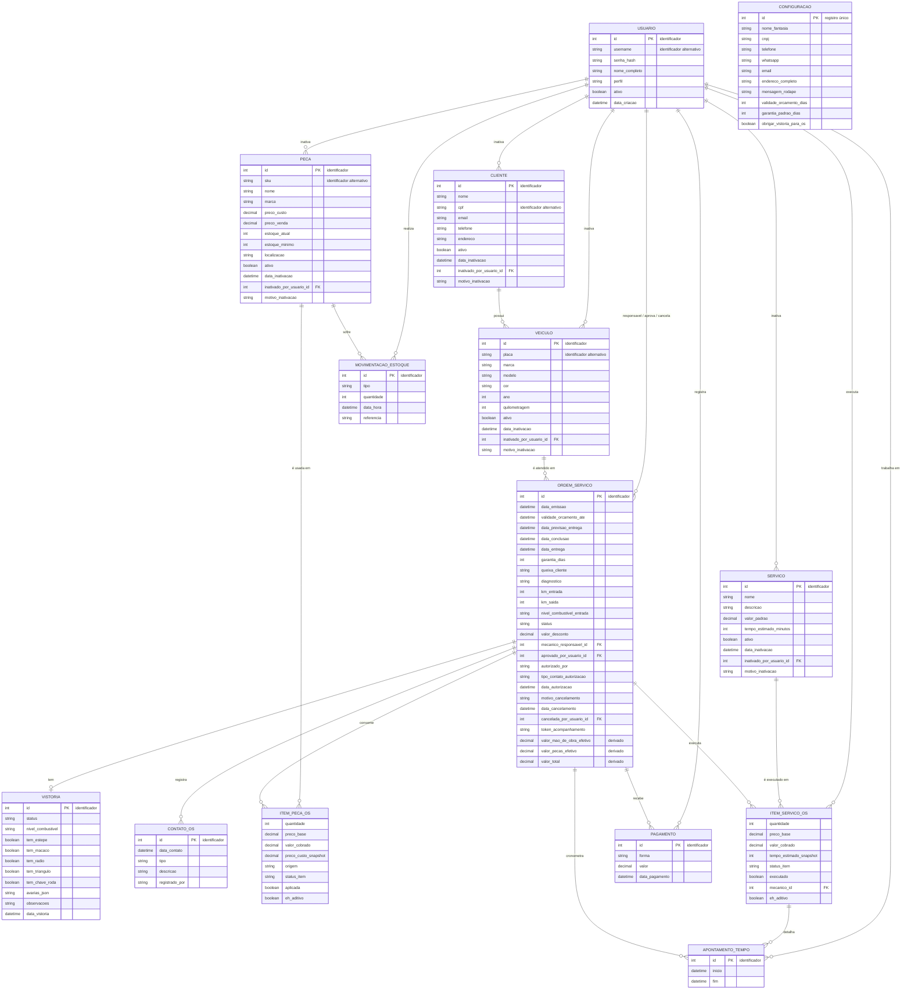
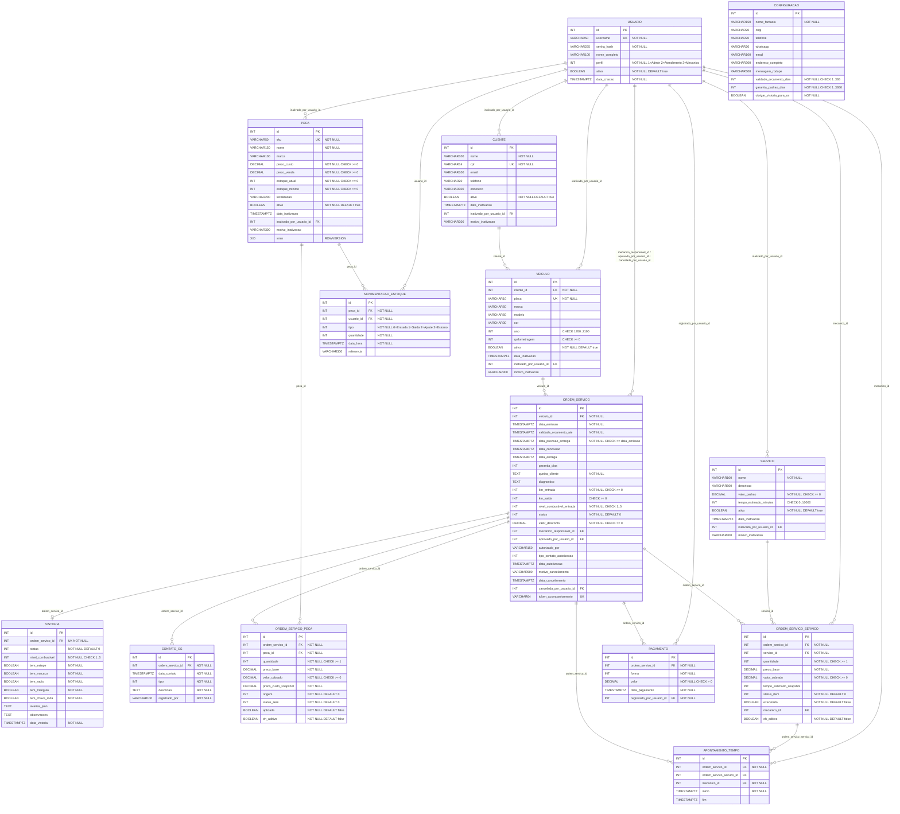

# Projeto Semestral — Etapa 1: Modelagem de Dados

**Sistema modelado:** MechSystem (gestão de oficina mecânica) — base: Projeto Integrador do semestre.

> Os diagramas abaixo são Mermaid. Para visualizar: preview do VS Code (extensão *Markdown Preview Mermaid Support*), GitHub, ou colar o código em <https://mermaid.live> para exportar PNG/PDF.

---

## 1. Definição do contexto do sistema

### 1.1 Nome / tema
**MechSystem** — sistema web para gestão de oficinas mecânicas (clientes, veículos, ordens de serviço, vistoria de entrada, catálogo de serviços, controle de estoque de peças e relatórios gerenciais).

### 1.2 Problema / necessidade
Oficinas pequenas e médias controlam orçamentos, ordens de serviço (OS) e estoque em papel ou planilhas. Isso gera:
- perda de histórico do cliente e do veículo;
- orçamentos sem registro de autorização (risco jurídico — CDC);
- divergência entre estoque físico e real de peças;
- falta de rastreio de quem alterou preços, deu desconto, inativou cadastros ou cancelou uma OS;
- ausência de registro do estado do veículo na entrada (disputas por avarias).

O sistema centraliza esses dados e garante que as regras da oficina sejam respeitadas.

### 1.3 Principais usuários / envolvidos
| Envolvido | Papel |
|---|---|
| **Administrador** | Configura a oficina, gerencia usuários, autoriza descontos, inativa/reativa cadastros e acessa relatórios financeiros |
| **Atendimento** | Cadastra clientes/veículos/peças/serviços, abre orçamentos e OS, registra contatos e consulta relatórios operacionais |
| **Mecânico** | Executa serviços, registra tempo gasto, realiza vistoria e consome peças pelo preço base |
| **Cliente** | Contrata serviços, autoriza orçamentos, acompanha a OS por token |

### 1.4 Principais funcionalidades relacionadas aos dados
- Cadastro de clientes e seus veículos com inativação lógica auditável (`IInativavel`).
- Catálogo de serviços (valor padrão e tempo estimado) e de peças (SKU, custo, venda, estoque) com inativação lógica auditável.
- Abertura e edição de OS com queixa do cliente (`QueixaCliente`), diagnóstico técnico (`Diagnostico`), quilometragem de entrada/saída (`KmEntrada`/`KmSaida`), nível de combustível na entrada (`NivelCombustivelEntrada`), validade do orçamento congelada (`ValidadeOrcamentoAte`), garantia congelada na entrega (`GarantiaDias`), peças, serviços, desconto (exclusivo para Administrador), cálculo de total e controle de status.
- Vistoria de entrada (combustível, itens do veículo, avarias).
- Apontamento de tempo de execução por mecânico e por item de serviço (`ApontamentoTempo`) e registro de pagamentos na entrega (`Pagamento`).
- Registro de contatos com o cliente sobre a OS (incluindo log automático quando a previsão de entrega é alterada após aprovação).
- Movimentação de estoque (entrada, saída, ajuste, estorno) com responsável.
- Controle de acesso por perfil e parâmetros globais da oficina.

### 1.5 Regras de negócio consideradas na modelagem
| # | Regra |
|---|---|
| RN01 | Um cliente pode ter vários veículos, mas cada veículo pertence a apenas **um** cliente. |
| RN02 | O CPF do cliente é obrigatório e **único**; a placa do veículo é obrigatória e **única**. Caso o identificador pertença a um registro inativo, o sistema informa e orienta a reativação. |
| RN03 | Um veículo pode ter várias ordens de serviço ao longo do tempo; cada OS refere-se a **um único** veículo. |
| RN04 | Toda OS exige queixa do cliente (`QueixaCliente`), quilometragem de entrada (`KmEntrada`), nível de combustível (`NivelCombustivelEntrada`), validade do orçamento congelada na emissão (`ValidadeOrcamentoAte`) e **data de previsão de entrega** (CDC), que não pode ser anterior à emissão. O diagnóstico técnico (`Diagnostico`) é separado da queixa e preenchido posteriormente. |
| RN05 | Uma OS tem no máximo **uma** vistoria de entrada; cada vistoria pertence a uma única OS. (A obrigatoriedade antes da aprovação é parametrizável em `Configuracao.ObrigarVistoriaParaOS`.) |
| RN06 | Uma OS pode conter várias peças e vários serviços; a mesma peça/serviço pode aparecer em várias OS, com **quantidade**, **valores próprios**, **status de aprovação individual** (`StatusItem`: Pendente, Aprovado, Recusado), indicador de **aditivo** (`EhAditivo`) e flag de execução/aplicação (`Executado`/`Aplicada`) por OS. |
| RN07 | Ao incluir peça/serviço na OS, os valores de catálogo (preço base, custo, tempo) são **copiados** (snapshot); alterar ou inativar o catálogo depois não altera OS antigas. Peças também registram sua `Origem` (`Estoque`, `SobDemanda`, `ClienteTrouxe`). |
| RN08 | Valor cobrado abaixo do preço base ou `ValorDesconto > 0` na OS configura desconto e exige perfil **Administrador**. |
| RN09 | Quantidades em OS e movimentações devem ser **≥ 1**; estoque atual e mínimo **não podem ser negativos**. |
| RN10 | O SKU da peça é único. Clientes, Veículos, Peças e Serviços não sofrem exclusão física (`DELETE`): utilizam *Soft Delete* padronizado (`IInativavel`) com bloqueio se houver OS em aberto (e se `EstoqueAtual > 0` para Peça). |
| RN11 | Toda movimentação de estoque pertence a **uma** peça e é feita por **um** usuário (rastreabilidade). |
| RN12 | O nome de usuário é único; cada usuário tem exatamente **um** perfil (Administrador, Atendimento, Mecânico). |
| RN13 | Cada OS possui status único controlado por máquina de estados: `Orcamento` (0), `EmAndamento` (1), `Pausada` (2), `AguardandoPecas` (3), `Concluida` (4), `Cancelada` (5), `Aprovada` (6), `AguardandoCliente` (7), `Entregue` (8) ou `Recusada` (9). |
| RN14 | Uma OS pode ter vários registros de contato com o cliente (ligação, WhatsApp, e-mail, presencial, outro), e a aprovação registra o canal em `TipoContatoAutorizacao` e o operador em `AprovadoPorUsuarioId`. |
| RN15 | Uma OS **nunca é excluída fisicamente**; quando interrompida, transita para `Cancelada` exigindo motivo (`MotivoCancelamento`), data (`DataCancelamento`) e usuário responsável (`CanceladaPorUsuarioId`). |
| RN16 | Existe **um único** registro de configuração da oficina (nome, CNPJ, validade do orçamento, garantia padrão e exigência de vistoria). |
| RN17 | Fonte única de valores: não existem campos manuais avulsos de mão de obra ou peças na OS. `ValorMaoDeObraEfetivo` e `ValorPecasEfetivo` são a soma das linhas com `StatusItem != Recusado`, e `ValorTotal = (ValorMaoDeObraEfetivo + ValorPecasEfetivo) − ValorDesconto` (**atributos derivados**, não armazenados). |
| RN18 | O tempo trabalhado é registrado em `ApontamentoTempo` (vinculado à OS, opcionalmente ao item de serviço, e ao mecânico, com índice parcial para apontamentos abertos `fim IS NULL`). Os recebimentos são registrados em `Pagamento` (forma, valor, data e usuário). |

> **Exemplo (como a regra aparece nos diagramas):** RN01 → relacionamento `CLIENTE (1,1) — possui — (0,N) VEICULO` no conceitual e `veiculo.cliente_id FK NOT NULL` no lógico.

---

## 2. Diagrama Conceitual (DER)

Notação de cardinalidade (mín,máx) lida a partir de cada entidade:

| Símbolo Mermaid | Significado |
|---|---|
| `\|\|` | exatamente um (1,1) |
| `o\|` | zero ou um (0,1) |
| `o{` | zero ou muitos (0,N) |
| `\|{` | um ou muitos (1,N) |

Entidades associativas: **ITEM_PECA_OS** (OS × PECA) e **ITEM_SERVICO_OS** (OS × SERVICO). **MOVIMENTACAO_ESTOQUE** também é associativa (PECA × USUARIO), com identidade própria por poder repetir-se.



### Cardinalidades (mín,máx)

| Relacionamento | Lado A | Lado B | Regra |
|---|---|---|---|
| CLIENTE **possui** VEICULO | CLIENTE (0,N) | VEICULO (1,1) | RN01 |
| VEICULO **é atendido em** ORDEM_SERVICO | VEICULO (0,N) | ORDEM_SERVICO (1,1) | RN03 |
| ORDEM_SERVICO **tem** VISTORIA | ORDEM_SERVICO (0,1) | VISTORIA (1,1) | RN05 |
| ORDEM_SERVICO **registra** CONTATO_OS | ORDEM_SERVICO (0,N) | CONTATO_OS (1,1) | RN14 |
| ORDEM_SERVICO **consome** PECA (assoc. ITEM_PECA_OS) | ORDEM_SERVICO (0,N) | PECA (0,N) | RN06 |
| ORDEM_SERVICO **executa** SERVICO (assoc. ITEM_SERVICO_OS) | ORDEM_SERVICO (0,N) | SERVICO (0,N) | RN06 |
| ORDEM_SERVICO **cronometra** APONTAMENTO_TEMPO | ORDEM_SERVICO (0,N) | APONTAMENTO_TEMPO (1,1) | RN18 |
| ORDEM_SERVICO **recebe** PAGAMENTO | ORDEM_SERVICO (0,N) | PAGAMENTO (1,1) | RN18 |
| PECA **sofre** MOVIMENTACAO_ESTOQUE | PECA (0,N) | MOVIMENTACAO (1,1) | RN11 |
| USUARIO **realiza** MOVIMENTACAO_ESTOQUE | USUARIO (0,N) | MOVIMENTACAO (1,1) | RN11 |
| USUARIO **inativa** CLIENTE / VEICULO / PECA / SERVICO | USUARIO (0,N) | Entidade (0,1) | RN10 |
| USUARIO **responsável / aprova / cancela** ORDEM_SERVICO | USUARIO (0,N) | ORDEM_SERVICO (0,1) | RN14/RN15 |
| CONFIGURACAO | sem relacionamentos (parâmetros globais, registro único) | | RN16 |

---

## 3. Diagrama Lógico (Modelo Relacional)

Convenções: `PK` chave primária · `FK` chave estrangeira · `UK` restrição UNIQUE.
Valores `decimal` = `DECIMAL(18,2)`. Campos de enum são armazenados como `INT`. `avarias_json` é `TEXT` com JSON.



### 3.1 Restrições adicionais (UNIQUE compostas e regras)

| Tabela | Restrição | Motivo |
|---|---|---|
| `ordem_servico_peca` | `UNIQUE (ordem_servico_id, peca_id)` | evita a mesma peça repetida em linhas na mesma OS (a quantidade controla o volume) — RN06 |
| `ordem_servico_servico` | `UNIQUE (ordem_servico_id, servico_id)` | idem para serviços — RN06 |
| `vistoria` | `UNIQUE (ordem_servico_id)` | garante a cardinalidade (0,1) da OS — RN05 |
| `cliente` | `UNIQUE (cpf)` | RN02 |
| `veiculo` | `UNIQUE (placa)` | RN02 |
| `peca` | `UNIQUE (sku)` | RN10 |
| `usuario` | `UNIQUE (username)` | RN12 |
| `apontamento_tempo` | `INDEX (mecanico_id, fim) WHERE fim IS NULL` | índice parcial para localizar rapidamente apontamento aberto por mecânico — RN18 |

### 3.2 Ações referenciais (ON DELETE)

| FK | Ação | Regra |
|---|---|---|
| `ordem_servico_peca.ordem_servico_id` | **CASCADE** | integridade interna da OS |
| `ordem_servico_servico.ordem_servico_id` | **CASCADE** | integridade interna da OS |
| `ordem_servico_peca.peca_id` | **RESTRICT** | RN10 |
| `movimentacao_estoque.peca_id` | **RESTRICT** | RN10 |
| `movimentacao_estoque.usuario_id` | **RESTRICT** | RN11 |
| `*.inativado_por_usuario_id`, `ordem_servico.cancelada_por_usuario_id` | **SET NULL** | preserva auditoria mesmo se conta de usuário for removida |
| `ordem_servico.mecanico_responsavel_id`, `ordem_servico.aprovado_por_usuario_id`, `ordem_servico_servico.mecanico_id`, `apontamento_tempo.*`, `pagamento.*` | **RESTRICT** | preservar rastreabilidade de execução, aprovação e recebimento |
| `veiculo.cliente_id`, `ordem_servico.veiculo_id`, `vistoria.ordem_servico_id`, `contato_os.ordem_servico_id`, `ordem_servico_servico.servico_id` | **RESTRICT** | preservar histórico |

### 3.3 Atributos derivados (não armazenados)
- `ordem_servico.valor_mao_de_obra_efetivo = SUM(ordem_servico_servico.subtotal) WHERE status_item != Recusado`
- `ordem_servico.valor_pecas_efetivo = SUM(ordem_servico_peca.subtotal) WHERE status_item != Recusado`
- `ordem_servico.valor_total = (valor_mao_de_obra_efetivo + valor_pecas_efetivo) − valor_desconto`
- `ordem_servico.tempo_real_total_minutos = SUM(fim - inicio) de apontamento_tempo`
- `Subtotal` do item = `quantidade × valor_cobrado`
- Margem de lucro da peça = `(preco_venda − preco_custo) / preco_venda × 100`

---

## 4. Coerência entre os modelos

```
Regras de negócio  →  Modelo Conceitual  →  Modelo Lógico
```

| Conceitual | Lógico | Transformação |
|---|---|---|
| Entidade | Tabela | 1 para 1 |
| Atributo identificador | PK | `id` surrogate; identificadores naturais (CPF, placa, SKU, username) viram `UNIQUE` |
| Relacionamento 1:N | FK no lado N | `VEICULO.cliente_id`, `ORDEM_SERVICO.veiculo_id`, `CONTATO_OS.ordem_servico_id`, `MOVIMENTACAO_ESTOQUE.peca_id/usuario_id` |
| Relacionamento 1:(0,1) | FK + `UNIQUE` | `VISTORIA.ordem_servico_id UNIQUE` |
| Relacionamento N:M com atributos | Entidade associativa → tabela com 2 FKs | `ITEM_PECA_OS` → `ORDEM_SERVICO_PECA`; `ITEM_SERVICO_OS` → `ORDEM_SERVICO_SERVICO` |
| Cardinalidade mínima 1 (obrigatória) | `NOT NULL` na FK | FKs estruturais |
| Auditoria de inativação/cancelamento | FK opcional (`NULL` enquanto ativo/não cancelado) | `inativado_por_usuario_id`, `cancelada_por_usuario_id` |
| Atributo derivado | não persistido | `valor_total` |
| Entidade sem relacionamento | Tabela isolada | `CONFIGURACAO` |

---

## 5. Observações de aderência ao código atual (Entrega de CRUDs e Relatórios)

Modelo derivado das entidades em `Models/` e do [AppDbContext.cs](../Data/AppDbContext.cs):
- `Cliente`, `Veiculo`, `Peca` e `Servico` implementam `IInativavel` (`Ativo`, `DataInativacao`, `InativadoPorUsuarioId`, `MotivoInativacao`), adicionados na migration `20261104224438_PadronizarSoftDeleteInativavel`. Sem `HasQueryFilter` global para preservar o histórico de O.S. antigas.
- `OrdemServico` possui campos de auditoria de cancelamento (`MotivoCancelamento`, `DataCancelamento`, `CanceladaPorUsuarioId`), adicionados na migration `20261104230924_AddCancelamentoAuditoriaOrdemServico`.
- `cliente.cpf`, `veiculo.placa`, `peca.sku` e `ordem_servico.token_acompanhamento` possuem índices `UNIQUE` no banco PostgreSQL (além de normalização automática na aplicação e detecção de duplicidade com registro inativo).
- `ordem_servico.data_conclusao` (`TIMESTAMPTZ NULL`) é preenchida automaticamente na conclusão da OS para apuração financeira por competência de conclusão via `RelatorioService`.
- `peca.xmin` (`Version`) é configurado como token nativo de concorrência otimista do PostgreSQL (`IsRowVersion()`).
- Todas as colunas `DateTime` são persistidas em UTC (`timestamp with time zone`) via convenção global no `AppDbContext`.
- **Refatoração do Fluxo O.S. — Fase 1 (Modelo de Dados e Migração Aditiva)**:
  - `20261105225909_Fase1AditivaFluxoOS`: migration 100% aditiva criando as novas colunas (`queixa_cliente`, `diagnostico`, `km_entrada`, `km_saida`, `nivel_combustivel_entrada`, `validade_orcamento_ate`, `garantia_dias`, `mecanico_responsavel_id`, `aprovado_por_usuario_id`, `tipo_contato_autorizacao`, `data_entrega`), campos em `ordem_servico_servico` (`status_item`, `executado`, `mecanico_id`, `eh_aditivo`) e `ordem_servico_peca` (`origem`, `status_item`, `aplicada`, `eh_aditivo`), além das tabelas `apontamento_tempo` (com índice parcial `WHERE fim IS NULL`) e `pagamento`, seguida de script SQL idempotente de migração de dados:
    - Copia `descricao_problema_relatado` para `queixa_cliente`.
    - Para O.S. sem linhas de serviço e com `valor_mao_de_obra > 0`, cria o serviço de catálogo inativo `"Mão de obra (migrado)"` e insere a linha correspondente em `ordem_servico_servico`.
    - **Decisão documentada sobre peça genérica migrada**: para O.S. sem linhas de peça e com `valor_pecas > 0`, optou-se por criar uma peça genérica inativa no catálogo (`SKU = 'MIGRADO-PECA-GEN'`, `nome = 'Peças diversas (migrado)'`, `ativo = false`, `motivo_inativacao = 'Item genérico criado automaticamente na migração da Fase 1'`) e vincular uma linha em `ordem_servico_peca` com o `valor_pecas` legado, garantindo que 100% do histórico financeiro passe a vir exclusivamente das linhas de itens sem perda de valor.
    - Converte O.S. antigas `Concluida` (4) para `Entregue` (8) com `data_entrega = COALESCE(data_conclusao, data_previsao_entrega, data_emissao)`.
    - Mapeia `meio_autorizacao` textual para o enum `tipo_contato_autorizacao` (`Presencial`, `WhatsApp`, `Telefone → Ligacao`, `E-mail → Email`, demais → `Outro`).
    - Preenche `validade_orcamento_ate = data_emissao + INTERVAL '10 days'` retroativamente e `km_entrada` a partir de `vistoria.quilometragem_entrada` ou `veiculo.quilometragem`.
  - `20261105231257_Fase1RemoverColunasLegadasFluxoOS`: segunda migration que remove as colunas legadas (`descricao_problema_relatado`, `valor_mao_de_obra`, `valor_pecas`, `servico_a_executar`, `data_previsao_inicio`, `meio_autorizacao`, `tempo_gasto_minutos`, `inicio_ultima_execucao`, `vistoria.quilometragem_entrada`, `configuracao.taxa_mao_de_obra` e `configuracao.simbolo_moeda`) somente após a execução do script de dados.

Fora do escopo de tabelas próprias: classes `Relatorio*` (DTOs de agregação e exportação CSV gerados por `RelatorioService`; não possuem `DbSet` no contexto) e `Login` (DTO de autenticação).

---

## 6. Roteiro sugerido para a apresentação (3–5 min)

1. **Contexto (1 min):** nome, problema, usuários, funcionalidades (seção 1).
2. **Regras de negócio (1 min):** destacar RN01, RN05, RN06, RN07, RN08, RN10 e RN15.
3. **Conceitual (1–2 min):** entidades, identificadores, cardinalidades e as 2 associativas.
4. **Lógico (1 min):** mostrar a conversão (seção 4), PKs/FKs, `UNIQUE`, `NOT NULL`, auditoria de inativação/cancelamento e `ON DELETE`.
5. **Coerência:** demonstrar RN01 e RN10 do conceitual ao lógico.
