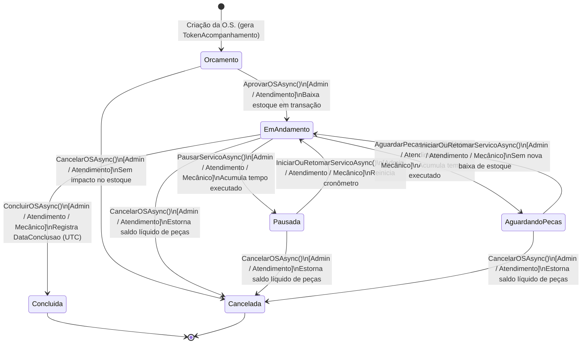

# Arquitetura, Regras de Negócio e Conformidade LGPD — MechSystem

Este documento consolida a especificação técnica da máquina de estados da Ordem de Serviço (O.S.), a matriz de autorização por perfil, a regra transacional de estoque, as decisões arquiteturais (ADRs) e o mapeamento de proteção de dados pessoais (LGPD) para apresentação à banca avaliadora.

---

## 1. Máquina de Estados da Ordem de Serviço (`OrdemServicoService`)

Toda transição de status de uma Ordem de Serviço é centralizada e validada no servidor por `Services/OrdemServicoService.cs` (`TransicoesPermitidas`). Nenhuma página Blazor altera `os.Status` diretamente.

### Regras de Transição
1. **`Orcamento` (Estado Inicial)**: Peças e serviços podem ser orçados livremente sem reservar nem descontar saldo físico do estoque.
2. **`EmAndamento` (Execução Ativa)**: Atingido na aprovação do orçamento (`AprovarOSAsync`, que exige vistoria prévia caso `Configuracao.ObrigarVistoriaParaOS == true` e baixa todas as peças vinculadas em transação única) ou na retomada após pausa/espera de peça.
3. **`Pausada` e `AguardandoPecas` (Estados Intermediários com Estoque Baixado)**: Pausam o cronômetro de execução (`AcumularTempoExecucao`), mantendo as peças já baixadas alocadas à O.S. Retomar o serviço (`IniciarOuRetomarServicoAsync`) volta para `EmAndamento` sem baixar novamente.
4. **`Concluida` (Estado Final Imutável)**: Preenche `DataConclusao = DateTime.UtcNow`, encerra o cronômetro e bloqueia qualquer alteração de itens, reabertura ou cancelamento.
5. **`Cancelada` (Estado Final Imutável)**: Se a O.S. estava em estado com estoque baixado (`EmAndamento`, `Pausada` ou `AguardandoPecas`), realiza automaticamente o estorno integral das peças vinculadas.

---

## 2. Matriz de Papéis × Ações (Autorização Server-Side)

Além da ocultação visual na interface (`<AuthorizeView>`), todas as operações críticas validam o perfil do usuário autenticado diretamente na camada de serviço (`OrdemServicoService`, `UsuarioService` e atributos `[Authorize(Roles = ...)]`):

| Ação / Operação | `Administrador` | `Atendimento` | `Mecanico` | Público (`AllowAnonymous`) |
|---|:---:|:---:|:---:|:---:|
| Criar O.S. / Orçamento (`/ordens-servico/nova`) | ✅ | ✅ | ❌ | ❌ |
| Realizar Checklist de Vistoria | ✅ | ✅ | ✅ | ❌ |
| Aprovar Orçamento (`AprovarOSAsync`) | ✅ | ✅ | ❌ | ❌ |
| Cancelar O.S. (`CancelarOSAsync`) | ✅ | ✅ | ❌ | ❌ |
| Iniciar / Retomar Execução (`IniciarOuRetomarServicoAsync`) | ✅ | ✅ | ✅ | ❌ |
| Pausar Execução (`PausarServicoAsync`) | ✅ | ✅ | ✅ | ❌ |
| Marcar Aguardando Peças (`AguardarPecasAsync`) | ✅ | ✅ | ✅ | ❌ |
| Concluir O.S. (`ConcluirOSAsync`) | ✅ | ✅ | ✅ | ❌ |
| Adicionar Peça pelo Preço Base (`AdicionarPecaAsync`) | ✅ | ✅ | ✅ (Painel) | ❌ |
| Adicionar Peça **com Desconto** (`ValorCobrado < PrecoVenda`) | ✅ | ❌ (Bloqueado) | ❌ (Bloqueado) | ❌ |
| Remover Peça da O.S. (`RemoverPecaAsync`) | ✅ | ✅ | ❌ | ❌ |
| Cadastrar / Editar Peças e Registrar Entrada de Estoque | ✅ | ✅ | ❌ | ❌ |
| Gerenciar Usuários e Configurações da Oficina | ✅ | ❌ | ❌ | ❌ |
| Acompanhar O.S. via Token (`/acompanhar/{token}`) | ✅ | ✅ | ✅ | ✅ (Somente leitura) |

---

## 3. Regra de Estoque: Ponto Único de Verdade (`EstoqueService` + `PecaRepository`)

O controle de inventário segue estritamente o ciclo de vida da O.S., garantindo que nunca ocorra baixa em duplicidade nem saldo físico negativo:

| Momento no Ciclo da O.S. | Status da O.S. | Efeito no `Peca.EstoqueAtual` | Registro em `MovimentacaoEstoque` |
|---|---|---|---|
| Adição/remoção de peça durante orçamento | `Orcamento` | **Nenhum** (0) | Nenhum |
| Aprovação do orçamento (`AprovarOSAsync`) | `Orcamento` → `EmAndamento` | **Baixa** todas as peças da O.S. (`-Quantidade`) | `TipoMovimentacao.Saida`, `Quantidade = -qtd`, `DataHora = UTC`, `UsuarioId` do claim |
| Adição avulsa de peça em O.S. já aprovada (Detalhes ou Painel do Mecânico) | `EmAndamento`, `Pausada` ou `AguardandoPecas` | **Baixa imediata** (`-Quantidade`) | `TipoMovimentacao.Saida`, `Quantidade = -qtd`, `DataHora = UTC`, `UsuarioId` do claim |
| Remoção de item de peça em O.S. já aprovada (`RemoverPecaAsync`) | `EmAndamento`, `Pausada` ou `AguardandoPecas` | **Estorno imediato** (`+Quantidade`) | `TipoMovimentacao.Estorno`, `Quantidade = +qtd`, `DataHora = UTC`, `UsuarioId` do claim |
| Transição entre `EmAndamento` ⇄ `Pausada` / `AguardandoPecas` | Já aprovada | **Nenhum** (evita baixa duplicada) | Nenhum |
| Cancelamento de O.S. em orçamento | `Orcamento` → `Cancelada` | **Nenhum** | Nenhum |
| Cancelamento de O.S. já aprovada (`CancelarOSAsync`) | `EmAndamento` / `Pausada` / `AguardandoPecas` → `Cancelada` | **Estorno do saldo líquido** das peças que permanecem na O.S. | `TipoMovimentacao.Estorno`, `Quantidade = +qtd`, `DataHora = UTC`, `UsuarioId` do claim |

### Atomicidade e Concorrência Otimista
- **Transação de Banco (`BeginTransactionAsync`)**: Na aprovação da O.S., caso a 2ª ou N-ésima peça não possua estoque suficiente, toda a transação sofre *rollback*, nenhuma peça é baixada e a O.S. permanece em `Orcamento`.
- **Token de Concorrência (`xmin`)**: A entidade `Peca` mapeia a coluna de sistema `xmin` do PostgreSQL (`IsRowVersion()`). Se dois operadores movimentarem a mesma peça simultaneamente, o EF Core lança `DbUpdateConcurrencyException`, a transação é revertida e o usuário recebe mensagem clara orientando a atualizar a tela.

---

## 4. Decisões de Arquitetura (ADRs)

### ADR-01: Persistência Universal de Datas em UTC e Exibição em `America/Sao_Paulo`
- **Contexto**: O Npgsql 6+ exige `DateTimeKind.Utc` para colunas `timestamp with time zone` (`timestamptz`). O switch legado `Npgsql.EnableLegacyTimestampBehavior` mascarava inconsistências de fuso horário entre servidor/container (geralmente UTC) e usuários no Brasil (`America/Sao_Paulo`).
- **Decisão**: Removido o switch legado. Adicionado `UtcDateTimeConverter` global em `AppDbContext.ConfigureConventions` e migration convertendo todas as colunas de data para `timestamp with time zone`. Toda gravação no backend usa `DateTime.UtcNow`, e a camada de apresentação utiliza os métodos de extensão `.ToBrasiliaTime()` e `DateTimeExtensions.TodayBrasilia()`.

### ADR-02: Competência Financeira Baseada em `DataConclusao`
- **Contexto**: Filtrar faturamento e margem de lucro por `DataEmissao` ou `DataAutorizacao` distorcia os relatórios mensais quando uma O.S. era orçada em um mês e concluída no mês seguinte.
- **Decisão**: Adicionada a coluna `DataConclusao` (`DateTime?` em UTC) preenchida em `ConcluirOSAsync`. Tanto o Dashboard (`Home.razor`), quanto a Central de Relatórios (`Relatorios/Index.razor`) e o cálculo de margem real (`EstoqueService.GetMargemLucroRealAsync`) apuram receitas exclusivamente pelas O.S. com `Status == Concluida` e `DataConclusao` dentro do período consultado.

### ADR-03: Geração Local de QR Code (`QRCoder`) e Token na Criação
- **Contexto**: O uso anterior de `https://api.qrserver.com/v1/create-qr-code/?data=...` enviava a URL completa de acompanhamento de cada O.S. para um servidor externo de terceiros, expondo o token de acesso do cliente.
- **Decisão**: O `TokenAcompanhamento` passa a ser gerado na criação da O.S. (com índice `UNIQUE` no PostgreSQL), e o QR Code é renderizado em memória no próprio servidor utilizando a biblioteca open-source `QRCoder` (`PngByteQRCode` em Base64 Data URI), eliminando dependências externas e vazamento de metadados.

### ADR-04: Eliminação de Credenciais Fixas e Endurecimento de Sessão
- **Contexto**: Existia senha padrão fixa no código e duplicidade entre seed de migration e inicialização em `Program.cs`.
- **Decisão**: A senha inicial do `admin` é lida de `Admin:InitialPassword` (User Secrets / variável de ambiente) ou gerada com `RandomNumberGenerator.GetString` (16 caracteres) e exibida uma única vez no log de inicialização. Adicionado `OnValidatePrincipal` no Cookie Authentication para invalidar imediatamente sessões de usuários inativados ou cujo perfil tenha sido alterado, além de *Rate Limiting* (5 requisições/minuto por IP) no endpoint `/api/auth/login`.

---

## 5. Proteção de Dados Pessoais e Conformidade com a LGPD (Lei nº 13.709/2018)

### 5.1 Mapeamento de Dados Pessoais Coletados
| Titular | Dados Pessoais Coletados | Finalidade Específica | Base Legal (Art. 7º LGPD) |
|---|---|---|---|
| **Cliente** (`Cliente` / `Veiculo`) | Nome completo, CPF, telefone, e-mail, endereço residencial/comercial e placa do veículo | Identificação contratual do proprietário e do bem confiado à guarda da oficina; emissão de orçamento prévio e termo de garantia | **Execução de contrato** (Art. 7º, V) e **Cumprimento de obrigação legal** — Art. 40 do CDC (Lei nº 8.078/1990) (Art. 7º, II) |
| **Cliente** (`ContatoOS` / `OrdemServico`) | Nome do autorizador, meio de aceite, data/hora da autorização e histórico de interações | Comprovação do aceite do orçamento (prevenção de litígios) e comunicação sobre status do reparo | **Execução de contrato** (Art. 7º, V) e **Exercício regular de direitos** (Art. 7º, VI) |
| **Colaborador / Operador** (`Usuario`) | Nome completo, `username`, perfil de acesso e logs de movimentação de estoque (`UsuarioId`) | Controle de acesso ao sistema, segregação de funções e auditoria interna de baixas/entradas de estoque | **Execução de contrato** (Art. 7º, V) e **Legítimo interesse** do controlador na segurança patrimonial (Art. 7º, IX) |

### 5.2 Medidas Técnicas e Administrativas de Segurança (Art. 46 LGPD)
1. **Minimização na Página Pública (`/acompanhar/{token}`)**: A consulta pública exibe apenas dados operacionais do veículo (marca/modelo, placa, status da O.S., previsão de entrega e descrição dos serviços), **omitindo CPF, telefone, e-mail, endereço e valores financeiros detalhados** do titular.
2. **Prevenção de Vazamento a Terceiros**: Geração 100% local do QR Code (`QRCoder`), garantindo que links de acompanhamento nunca trafeguem para APIs externas.
3. **Controle de Acesso e Autenticação Forte**:
   - Senhas armazenadas exclusivamente como hashes `BCrypt` (`BCrypt.Net-Next`) com validação de política mínima (mínimo 8 caracteres, bloqueio de senhas comuns e proibição de senha igual ao login).
   - Cookies de sessão protegidos com `HttpOnly`, `SameSite=Strict`, `SecurePolicy=Always` fora de desenvolvimento e revogação imediata via `OnValidatePrincipal` caso o operador seja desativado.
   - Proteção contra enumeração de credenciais e força bruta via middleware `RateLimiter` no login.
4. **Sanitização e Unicidade**: CPF e telefones são normalizados (apenas dígitos) via `ValueConverter` no `AppDbContext`, evitando duplicidade cadastral e inconsistências.
5. **Retenção e Exclusão Lógica (*Soft Delete*)**: A exclusão de um cliente marca `Ativo = false` (ocultando-o das operações cotidianas por *Global Query Filter*), mantendo apenas a integridade referencial de ordens de serviço pretéritas pelo prazo legal de garantia e obrigações fiscais/contratuais.
6. **Tratamento Seguro de Erros (`DomainErrorHelper`)**: Exceções internas de banco ou infraestrutura são registradas apenas no `ILogger` do servidor, nunca expondo *stack traces*, nomes de tabelas ou dados sensíveis na interface do usuário.
