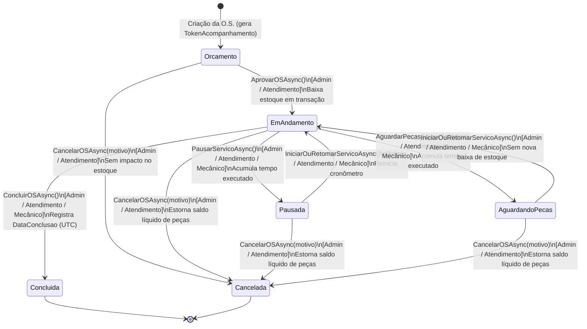

# Arquitetura, Regras de Negócio e Conformidade LGPD — MechSystem

Este documento consolida a especificação técnica da máquina de estados da Ordem de Serviço (O.S.), a matriz de autorização por perfil, a regra transacional de estoque, a política de inativação lógica (*Soft Delete*), as decisões arquiteturais (ADRs) e o mapeamento de proteção de dados pessoais (LGPD) para apresentação à banca avaliadora.

---

## 1. Máquina de Estados da Ordem de Serviço (`OrdemServicoService`)

Toda transição de status e edição de uma Ordem de Serviço é centralizada e validada no servidor por `Services/OrdemServicoService.cs` (`TransicoesPermitidas` e `AtualizarOSAsync`). Nenhuma página Blazor altera `os.Status` diretamente.

### Regras de Transição e Edição (`AtualizarOSAsync`) e Modelo da Fase 1
1. **`Orcamento` (Estado Inicial)**: Peças e serviços podem ser orçados livremente sem reservar nem descontar saldo físico do estoque. Na abertura da O.S., são registrados obrigatoriamente `QueixaCliente`, `KmEntrada`, `NivelCombustivelEntrada` e `ValidadeOrcamentoAte` (`DataEmissao + Configuracao.ValidadeOrcamentoDias`). Permite editar queixa do cliente (`QueixaCliente`), diagnóstico técnico (`Diagnostico`), previsão de entrega (`DataPrevisaoEntrega >= DataEmissao`), catálogo de serviços vinculados e desconto (`ValorDesconto`, restrito ao perfil `Administrador`).
2. **Fonte Única de Valores (Fase 1)**: Foram removidos os campos avulsos `ValorMaoDeObra`, `ValorPecas` e `ServicoAExecutar`. `ValorMaoDeObraEfetivo` e `ValorPecasEfetivo` são calculados exclusivamente pela soma das linhas de `OrdemServicoServico` e `OrdemServicoPeca` com `StatusItem != StatusItem.Recusado`, e `ValorTotal = (ValorMaoDeObraEfetivo + ValorPecasEfetivo) - ValorDesconto`.
3. **Novos Estados, Entidades e Campos Preparados na Fase 1**:
   - Enum `OrdemServicoStatus` ampliado (sem renumerar `0..5`) com `Aprovada = 6`, `AguardandoCliente = 7`, `Entregue = 8` e `Recusada = 9`.
   - Itens de serviço (`OrdemServicoServico`) possuem `StatusItem` (`Pendente`, `Aprovado`, `Recusado`), `Executado`, `MecanicoId` e `EhAditivo`.
   - Itens de peça (`OrdemServicoPeca`) possuem `Origem` (`Estoque`, `SobDemanda`, `ClienteTrouxe`), `StatusItem`, `Aplicada` e `EhAditivo`.
   - Entidades `ApontamentoTempo` (cronometragem por mecânico/serviço com índice parcial `WHERE fim IS NULL`) e `Pagamento` (recebimentos por forma de pagamento na entrega).
4. **`EmAndamento` (Execução Ativa)**: Atingido na aprovação do orçamento (`AprovarOSAsync`, que exige vistoria prévia caso `Configuracao.ObrigarVistoriaParaOS == true` e grava `AprovadoPorUsuarioId` e `TipoContatoAutorizacao`) ou na retomada após pausa/espera de peça.
5. **`Pausada` e `AguardandoPecas` (Estados Intermediários com Estoque Baixado)**: Pausam a execução mantendo as peças já baixadas alocadas à O.S. Retomar o serviço (`IniciarOuRetomarServicoAsync`) volta para `EmAndamento` sem baixar novamente.
6. **Edição Pós-Aprovação (`Aprovada`, `EmAndamento`, `Pausada`, `AguardandoPecas`, `AguardandoCliente`)**: Após a aprovação do cliente, a queixa inicial (`QueixaCliente`), o escopo contratado e o desconto ficam bloqueados para edição; apenas o **diagnóstico técnico** (`Diagnostico`) e a **previsão de entrega** (`DataPrevisaoEntrega >= DataEmissao`) podem ser atualizados, gerando automaticamente um registro de auditoria em `ContatoOS` quando a previsão muda (`"Previsão alterada de X para Y por <usuário>"`).
7. **`Concluida` e `Entregue` (Estados de Encerramento Operacional)**: `Concluida` preenche `DataConclusao = DateTime.UtcNow`; `Entregue` registra `DataEntrega`, `KmSaida` e o snapshot `GarantiaDias` (a máquina de estados completa de aprovação/execução/aditivos/entrega será expandida na Fase 2).
8. **`Cancelada` (Estado Final Imutável com Auditoria)**: Exige motivo obrigatório (`MotivoCancelamento`, mínimo de 5 caracteres), registra `DataCancelamento = DateTime.UtcNow` e `CanceladaPorUsuarioId`. Se a O.S. estava em estado com estoque baixado (`EmAndamento`, `Pausada` ou `AguardandoPecas`), realiza automaticamente o estorno integral das peças vinculadas.

---

## 2. Matriz de Papéis × Ações (Autorização Server-Side)

Além da ocultação visual na interface (`<AuthorizeView>`), todas as operações críticas validam o perfil do usuário autenticado diretamente na camada de serviço (`OrdemServicoService`, `InativacaoService`, `UsuarioService` e atributos `[Authorize(Roles = ...)]`):

| Ação / Operação | `Administrador` | `Atendimento` | `Mecanico` | Público (`AllowAnonymous`) |
|---|:---:|:---:|:---:|:---:|
| Criar O.S. / Orçamento (`/ordens-servico/nova`) | ✅ | ✅ | ❌ | ❌ |
| Editar O.S. (`AtualizarOSAsync`) | ✅ (inclui Desconto) | ✅ (sem alterar Desconto) | ❌ | ❌ |
| Realizar Checklist de Vistoria | ✅ | ✅ | ✅ | ❌ |
| Aprovar Orçamento (`AprovarOSAsync`) | ✅ | ✅ | ❌ | ❌ |
| Cancelar O.S. com Motivo (`CancelarOSAsync`) | ✅ | ✅ | ❌ | ❌ |
| Iniciar / Retomar / Pausar / Concluir Execução | ✅ | ✅ | ✅ | ❌ |
| Adicionar Peça pelo Preço Base (`AdicionarPecaAsync`) | ✅ | ✅ | ✅ (Painel) | ❌ |
| Adicionar Peça **com Desconto** (`ValorCobrado < PrecoVenda`) | ✅ | ❌ (Bloqueado) | ❌ (Bloqueado) | ❌ |
| Remover Peça da O.S. (`RemoverPecaAsync`) | ✅ | ✅ | ❌ | ❌ |
| Cadastrar / Editar Clientes, Veículos, Peças e Serviços | ✅ | ✅ | ❌ (Consulta Veículos/Serviços) | ❌ |
| Inativar / Reativar Clientes, Veículos, Peças e Serviços (`InativacaoService`) | ✅ | ❌ (Bloqueado) | ❌ (Bloqueado) | ❌ |
| Acessar Central de Relatórios (`/relatorios`) — Abas Clientes / Serviços / Estoque | ✅ | ✅ | ❌ (Bloqueado) | ❌ |
| Acessar Aba **Financeiro** em Relatórios | ✅ | ❌ (Bloqueado no servidor) | ❌ (Bloqueado) | ❌ |
| Gerenciar Usuários e Configurações da Oficina | ✅ | ❌ | ❌ | ❌ |
| Acompanhar O.S. via Token (`/acompanhar/{token}`) | ✅ | ✅ | ✅ | ✅ (Somente leitura) |

---

## 3. Regra de Estoque: Ponto Único de Verdade (`EstoqueService` + `PecaRepository`)

O controle de inventário segue estritamente o ciclo de vida da O.S., garantindo que nunca ocorra baixa em duplicidade nem saldo físico negativo:

| Momento no Ciclo da O.S. | Status da O.S. | Efeito no `Peca.EstoqueAtual` | Registro em `MovimentacaoEstoque` |
|---|---|---|---|
| Adição/remoção de peça durante orçamento | `Orcamento` | **Nenhum** (0) | Nenhum |
| Aprovação do orçamento (`AprovarOSAsync`) | `Orcamento` → `EmAndamento` | **Baixa** todas as peças da O.S. (`-Quantidade`) | `TipoMovimentacao.Saida`, `Quantidade = -qtd`, `DataHora = UTC`, `UsuarioId` do claim |
| Adição avulsa de peça em O.S. já aprovada (Detalhes ou Painel do Mecânico) | `EmAndamento`, `Pausada` ou `AguardandoPecas` | **Baixa imediata** (`-Quantidade`) | `TipoMovimentacao.Saida`, `Quantidade = -qtd`, `DataHora = UTC`, `UsuarioId` do claim |
| Remoção de item de peça em O.S. já aprovada (`RemoverPecaAsync`) | `EmAndamento`, `Pausada` ou `AguardandoPecas` | **Estorno imediato** (`+Quantidade`) | `TipoMovimentacao.Estorno`, `Quantidade = +qtd`, `DataHora = UTC`, `UsuarioId` do claim |
| Transição entre `EmAndamento` ⇄ `Pausada` / `AguardandoPecas` | Já aprovada | **Nenhum** (evita baixa duplicada) | Nenhum |
| Cancelamento de O.S. em orçamento | `Orcamento` → `Cancelada` | **Nenhum** | Nenhum |
| Cancelamento de O.S. já aprovada (`CancelarOSAsync`) | `EmAndamento` / `Pausada` / `AguardandoPecas` → `Cancelada` | **Estorno do saldo líquido** das peças que permanecem na O.S. | `TipoMovimentacao.Estorno`, `Quantidade = +qtd`, `DataHora = UTC`, `UsuarioId` do claim |

### Atomicidade e Concorrência Otimista
- **Transação de Banco (`BeginTransactionAsync`)**: Na aprovação da O.S., caso a 2ª ou N-ésima peça não possua estoque suficiente, toda a transação sofre *rollback*, nenhuma peça é baixada e a O.S. permanece em `Orcamento`.
- **Token de Concorrência (`xmin`)**: A entidade `Peca` mapeia a coluna de sistema `xmin` do PostgreSQL (`IsRowVersion()`). Se dois operadores movimentarem a mesma peça simultaneamente, o EF Core lança `DbUpdateConcurrencyException`, a transação é revertida e o usuário recebe mensagem clara orientando a atualizar a tela.

---

## 4. Política de Soft Delete Padronizado (`IInativavel` + `InativacaoService`) e Imutabilidade Histórica de O.S.

### 4.1 Por que Inativação Lógica (*Soft Delete*) e não Exclusão Física (`DELETE`)?
Em uma oficina mecânica, Clientes, Veículos, Peças e Serviços participam diretamente de registros contratuais, fiscais e de garantia (Ordens de Serviço e Movimentações de Estoque). A exclusão física (`DELETE`) causaria um de dois problemas graves:
1. **Perda de histórico**: Excluir em cascata apagaria ordens de serviço concluídas, distorcendo o faturamento histórico, o livro de movimentações de estoque e o prontuário técnico do veículo.
2. **Erros de chave estrangeira (`DeleteBehavior.Restrict`)**: Impediria a limpeza operacional do catálogo quando um serviço deixa de ser oferecido ou quando uma peça sai de linha após já ter sido usada no passado.

Por isso, `Cliente`, `Veiculo`, `Peca` e `Servico` implementam a interface comum `IInativavel`:
- `Ativo` (`bool`, padrão `true`)
- `DataInativacao` (`DateTime?` em UTC)
- `InativadoPorUsuarioId` (`int?`, FK para `Usuario` com `DeleteBehavior.SetNull`)
- `MotivoInativacao` (`string?`, até 300 caracteres, obrigatório ao inativar com mínimo de 5 caracteres)

### 4.2 Por que NÃO usar `HasQueryFilter` Global no EF Core?
Um filtro global (`HasQueryFilter(e => e.Ativo)`) no `AppDbContext` ocultaria automaticamente registros inativos em **todos** os `Include()` do EF Core:
- Uma O.S. concluída há 6 meses cujo veículo ou cliente foi posteriormente inativado apareceria com `os.Veiculo == null` na tela de Detalhes, na Impressão da O.S. e nos Relatórios financeiros.
- Um serviço antigo que saiu do catálogo (`Servico.Ativo = false`) deixaria de aparecer na lista de serviços executados de O.S. históricas (`os.ServicosAExecutarList`).

**Decisão arquitetural**: Não há `HasQueryFilter` global em `AppDbContext`. Em vez disso, foram criados os métodos de extensão explícitos `.Ativos()` e `.Inativos()` em `IInativavelExtensions` (`Interfaces/IInativavel.cs`):
- **Telas de seleção e criação de novas O.S. / entradas de estoque** consultam explicitamente `.Ativos()`.
- **Consultas de histórico, detalhes de O.S., prontuário do veículo e relatórios de período** preservam a navegação completa sem amputar referências a cadastros posteriormente inativados.

### 4.3 Regras de Bloqueio, Cascata e Reativação (`InativacaoService`)
Todas as operações de inativação e reativação exigem perfil **`Administrador`** validado no servidor, executam em transação (`BeginTransactionAsync`) e seguem a tabela de regras abaixo:

| Entidade | Condição que Bloqueia a Inativação | Efeito Colateral na Inativação | Regra de Reativação | Tratamento de Duplicidade (Cadastro) |
|---|---|---|---|---|
| **Cliente** | Qualquer veículo do cliente possuir O.S. em aberto (`Orcamento`, `Aprovada`, `EmAndamento`, `Pausada`, `AguardandoPecas`, `AguardandoCliente`). | **Cascata controlada**: inativa também todos os veículos ativos do cliente (registrando data, usuário e motivo). | Reativa apenas o cliente; seus veículos permanecem inativos até serem reativados individualmente. | Se o CPF já pertencer a um cliente inativo, bloqueia e orienta: *"Já existe um cliente inativo com este CPF: \<nome\>. Reative-o em Clientes > Inativos."* |
| **Veículo** | Possuir O.S. em aberto (`Orcamento`, `Aprovada`, `EmAndamento`, `Pausada`, `AguardandoPecas`, `AguardandoCliente`). | Nenhum. Prontuário e O.S. concluídas/entregues/canceladas permanecem íntegros. | **Exige cliente proprietário ativo** (bloqueia caso `Veiculo.Cliente.Ativo == false`). | Se a placa já pertencer a um veículo inativo, bloqueia e orienta a reativação em *Veículos > Inativos*. |
| **Peça** | Estar vinculada a O.S. em aberto **OU** possuir `EstoqueAtual > 0` (*"zere o saldo por Ajuste antes de desativar"* — decisão conservadora porque o capital imobilizado soma apenas peças ativas). | Deixa de compor os indicadores de posição atual de peças ativas e capital imobilizado. | Permitida livremente para Administrador. | Se o SKU já pertencer a uma peça inativa, bloqueia e orienta a reativação em *Estoque > Inativos*. |
| **Serviço** | Estar vinculado a O.S. em aberto (`Orcamento`, `Aprovada`, `EmAndamento`, `Pausada`, `AguardandoPecas`, `AguardandoCliente`). | Sai do catálogo de criação/edição de O.S., mas continua visível em todas as O.S. antigas. | Permitida livremente para Administrador. | N/A (serviços são identificados por ID). |

### 4.4 Por que Ordem de Serviço NUNCA é Excluída?
Ordens de Serviço representam documentos contratuais e operacionais numerados sequencialmente (Art. 40 do Código de Defesa do Consumidor) e possuem vínculo direto com movimentações físicas de estoque, vistorias de entrada e registros de aceite/contato do cliente.
- **Decisão**: O sistema **não possui exclusão física nem inativação de O.S.** Caso um orçamento seja recusado ou um serviço precise ser interrompido definitivamente, utiliza-se exclusivamente a operação **Cancelar O.S. (`CancelarOSAsync`)**, que exige motivo obrigatório (`MotivoCancelamento`, mínimo de 5 caracteres), registra data/hora UTC (`DataCancelamento`) e o usuário responsável (`CanceladaPorUsuarioId`), além de estornar automaticamente o saldo de peças caso a O.S. já estivesse aprovada.

---

## 5. Decisões de Arquitetura (ADRs)

### ADR-01: Persistência Universal de Datas em UTC e Exibição em `America/Sao_Paulo`
- **Contexto**: O Npgsql 6+ exige `DateTimeKind.Utc` para colunas `timestamp with time zone` (`timestamptz`). O switch legado `Npgsql.EnableLegacyTimestampBehavior` mascarava inconsistências de fuso horário entre servidor/container (geralmente UTC) e usuários no Brasil (`America/Sao_Paulo`).
- **Decisão**: Removido o switch legado. Adicionado `UtcDateTimeConverter` global em `AppDbContext.ConfigureConventions` e migration convertendo todas as colunas de data para `timestamp with time zone`. Toda gravação no backend usa `DateTime.UtcNow`, e a camada de apresentação utiliza os métodos de extensão `.ToBrasiliaTime()` e `DateTimeExtensions.TodayBrasilia()`.

### ADR-02: Competência Financeira Baseada em `DataConclusao` e `RelatorioService` Único
- **Contexto**: Filtrar faturamento e margem de lucro por `DataEmissao` ou `DataAutorizacao` distorcia os relatórios mensais quando uma O.S. era orçada em um mês e concluída no mês seguinte. Além disso, o Dashboard (`Home.razor`) e a Central de Relatórios (`Relatorios/Index.razor`) possuíam lógicas duplicadas.
- **Decisão**: Adicionada a coluna `DataConclusao` (`DateTime?` em UTC) preenchida em `ConcluirOSAsync` e criado o serviço único `Services/RelatorioService.cs`, consumido tanto pela `Home.razor` quanto por `Relatorios/Index.razor`. As agregações são executadas no banco de dados preservando exatamente a regra de fallback de `ValorMaoDeObraEfetivo` e `ValorPecasEfetivo` (com teste automatizado de paridade comparando o resultado SQL com o cálculo em memória).

### ADR-03: Geração Local de QR Code (`QRCoder`) e Token na Criação
- **Contexto**: O uso anterior de `https://api.qrserver.com/v1/create-qr-code/?data=...` enviava a URL completa de acompanhamento de cada O.S. para um servidor externo de terceiros, expondo o token de acesso do cliente.
- **Decisão**: O `TokenAcompanhamento` passa a ser gerado na criação da O.S. (com índice `UNIQUE` no PostgreSQL), e o QR Code é renderizado em memória no próprio servidor utilizando a biblioteca open-source `QRCoder` (`PngByteQRCode` em Base64 Data URI), eliminando dependências externas e vazamento de metadados.

### ADR-04: Eliminação de Credenciais Fixas e Endurecimento de Sessão
- **Contexto**: Existia senha padrão fixa no código e duplicidade entre seed de migration e inicialização em `Program.cs`.
- **Decisão**: A senha inicial do `admin` é lida de `Admin:InitialPassword` (User Secrets / variável de ambiente) ou gerada com `RandomNumberGenerator.GetString` (16 caracteres) e exibida uma única vez no log de inicialização. Adicionado `OnValidatePrincipal` no Cookie Authentication para invalidar imediatamente sessões de usuários inativados ou cujo perfil tenha sido alterado, além de *Rate Limiting* (5 requisições/minuto por IP) no endpoint `/api/auth/login`.

---

## 6. Proteção de Dados Pessoais e Conformidade com a LGPD (Lei nº 13.709/2018)

### 6.1 Mapeamento de Dados Pessoais Coletados
| Titular | Dados Pessoais Coletados | Finalidade Específica | Base Legal (Art. 7º LGPD) |
|---|---|---|---|
| **Cliente** (`Cliente` / `Veiculo`) | Nome completo, CPF, telefone, e-mail, endereço residencial/comercial e placa do veículo | Identificação contratual do proprietário e do bem confiado à guarda da oficina; emissão de orçamento prévio e termo de garantia | **Execução de contrato** (Art. 7º, V) e **Cumprimento de obrigação legal** — Art. 40 do CDC (Lei nº 8.078/1990) (Art. 7º, II) |
| **Cliente** (`ContatoOS` / `OrdemServico`) | Nome do autorizador, meio de aceite, data/hora da autorização e histórico de interações | Comprovação do aceite do orçamento (prevenção de litígios) e comunicação sobre status do reparo | **Execução de contrato** (Art. 7º, V) e **Exercício regular de direitos** (Art. 7º, VI) |
| **Colaborador / Operador** (`Usuario`) | Nome completo, `username`, perfil de acesso e logs de auditoria (`UsuarioId` em movimentações, inativações e cancelamentos) | Controle de acesso ao sistema, segregação de funções e auditoria interna de baixas/entradas de estoque e cancelamentos | **Execução de contrato** (Art. 7º, V) e **Legítimo interesse** do controlador na segurança patrimonial (Art. 7º, IX) |

### 6.2 Medidas Técnicas e Administrativas de Segurança (Art. 46 LGPD)
1. **Minimização na Página Pública (`/acompanhar/{token}`)**: A consulta pública exibe apenas dados operacionais do veículo (marca/modelo, placa, status da O.S., previsão de entrega e descrição dos serviços), **omitindo CPF, telefone, e-mail, endereço e valores financeiros detalhados** do titular.
2. **Prevenção de Vazamento a Terceiros**: Geração 100% local do QR Code (`QRCoder`), garantindo que links de acompanhamento nunca trafeguem para APIs externas.
3. **Controle de Acesso e Autenticação Forte**:
   - Senhas armazenadas exclusivamente como hashes `BCrypt` (`BCrypt.Net-Next`) com validação de política mínima (mínimo 8 caracteres, bloqueio de senhas comuns e proibição de senha igual ao login).
   - Cookies de sessão protegidos com `HttpOnly`, `SameSite=Strict`, `SecurePolicy=Always` fora de desenvolvimento e revogação imediata via `OnValidatePrincipal` caso o operador seja desativado.
   - Proteção contra enumeração de credenciais e força bruta via middleware `RateLimiter` no login.
4. **Sanitização e Unicidade**: CPF e telefones são normalizados (apenas dígitos) via `ValueConverter` no `AppDbContext`, evitando duplicidade cadastral e inconsistências.
5. **Retenção Auditável e Exclusão Lógica (*Soft Delete* via `IInativavel`)**: A inativação de um cliente ou veículo marca `Ativo = false` com registro de data, responsável e motivo, ocultando-o das listagens operacionais padrão via filtro explícito `.Ativos()`, mas preservando a integridade referencial de ordens de serviço pretéritas pelo prazo legal de garantia e obrigações fiscais/contratuais.
6. **Tratamento Seguro de Erros (`DomainErrorHelper`)**: Exceções internas de banco ou infraestrutura são registradas apenas no `ILogger` do servidor, nunca expondo *stack traces*, nomes de tabelas ou dados sensíveis na interface do usuário.
